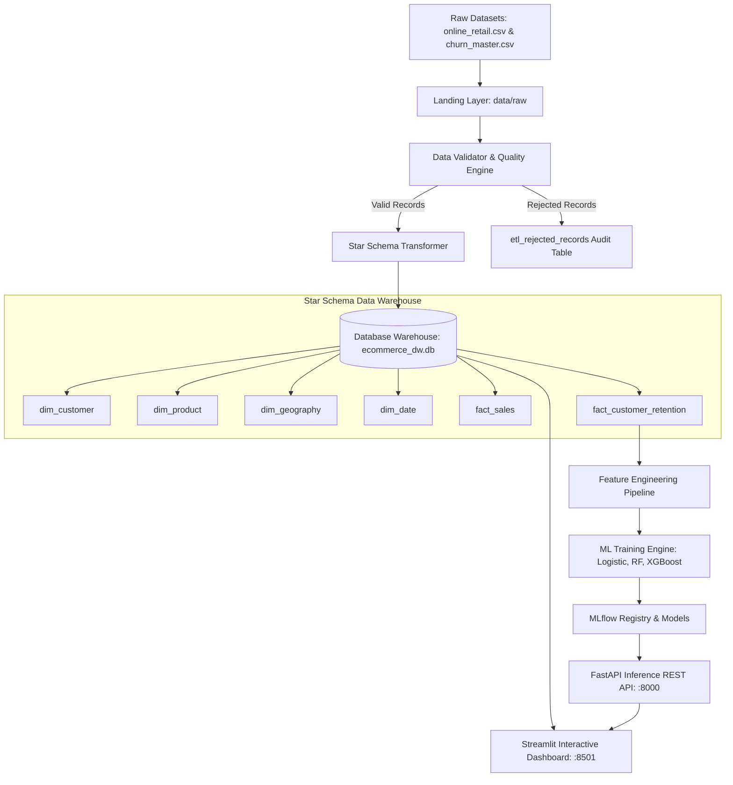

# E-Commerce Sales Analytics & Customer Churn Prediction (Data Engineering & MLOps Platform)

**Course**: Data Engineering and MLOps  
**Project**: Individual Capstone Project  
**Date**: October 2026  
**Status**: Fully Implemented & Deployed  

---

## 1. Executive Summary & Problem Understanding

In the modern e-commerce enterprise, retaining existing customers is significantly more cost-effective than acquiring new ones. This project builds an end-to-end, production-grade **Data Engineering and MLOps Platform** for online retail operations.

The platform addresses two key business objectives:
1. **Part 1 (Data Engineering & Data Warehouse)**: Establish an automated ETL pipeline that ingests raw transactional data, cleanses and validates records, and populates an analytical **Star Schema Data Warehouse** (SQL) coupled with an interactive **Streamlit Executive Dashboard**.
2. **Part 2 (MLOps Pipeline Extension)**: Formulate customer churn prediction using transactional recency, frequency, monetary (RFM) and demographic features, train ensemble machine learning models tracked via **MLflow**, serve inference via a **FastAPI REST API**, containerize services using **Docker**, and continuously monitor feature drift.

---

## 2. Data Sources & Ingestion Expectations

### 2.1 Primary & Supplementary Datasets
* **UCI Online Retail Dataset** (`online_retail.csv`): Contains 541,911 transaction records from a UK-based online gift retailer operating between Dec 2010 and Dec 2011. Key fields include `InvoiceNo`, `StockCode`, `Description`, `Quantity`, `InvoiceDate`, `UnitPrice`, `CustomerID`, and `Country`.
* **Synthetic Customer Master Dataset** (`ecommerce_customer_churn_large.csv`): Contains 200,000 customer demographic and behavioral profiles including `age`, `gender`, `city`, `tenure_months`, `avg_order_value`, `total_orders`, `support_tickets`, `subscription_type`, and `churn`.

### 2.2 Data Ingestion Expectations Compliance
* **Raw Copy Preservation**: Every execution copies immutable raw extracts into `data/raw/raw_online_retail_<timestamp>.csv`.
* **Audit Logging**: Logs extraction date, file status, total raw row count, valid row count, rejected count, and duration into `etl_extraction_log`.
* **Data Quality & Rejections**: Non-conforming records (negative prices, invalid dates, unparseable quantities) are captured in `etl_rejected_records` with detailed failure reasons.
* **No Manual Edits**: The analytical dataset is generated 100% programmatically without manual edits.

---

## 3. Data Architecture Design & Star Schema

The platform follows a multi-tiered data architecture:  
`Landing Area (data/raw)` -> `Validation & Staging` -> `Airflow / Script Orchestrator` -> `SQL Star Schema Data Warehouse` -> `Streamlit & FastAPI`



### 3.1 Data Warehouse Schema Definitions

1. **`dim_customer`**: `customer_id` (PK), `country`, `age`, `gender`, `city`, `tenure_months`, `subscription_type`, `support_tickets`.
2. **`dim_product`**: `stock_code` (PK), `description`, `category` (inferred high-level category), `unit_price`, `is_active`.
3. **`dim_geography`**: `geography_id` (PK), `country`, `city`, `region` (Domestic vs. International).
4. **`dim_date`**: `date_key` (PK, YYYYMMDD), `full_date`, `day`, `month`, `month_name`, `quarter`, `year`, `day_of_week`, `is_weekend`.
5. **`fact_sales`**: `sales_id` (PK), `invoice_no`, `stock_code` (FK), `customer_id` (FK), `date_key` (FK), `invoice_date`, `quantity`, `unit_price`, `total_revenue`, `country`, `is_cancelled`.
6. **`fact_customer_retention`**: `customer_id` (PK), `recency_days`, `frequency_orders`, `monetary_value`, `avg_order_value`, `total_items_bought`, `cancellation_count`, `rfm_segment`, `churn_label`.

---

## 4. ETL and Data Engineering Implementation

### 4.1 Data Validation Rules
* **Quantity**: Positive integer for regular orders. Quantities <= 0 with `InvoiceNo` starting with `C` are classified as order cancellations; otherwise flagged invalid.
* **UnitPrice**: Must be > £0.00. Records with price <= 0 are recorded in `etl_rejected_records`.
* **Standardization**: Currency standardized to GBP (£); dates converted to UTC ISO 8601 (`YYYY-MM-DD HH:MM:SS`).

---

## 5. Data Visualization (Streamlit Executive Dashboard)

The Streamlit dashboard (`app/streamlit_app.py`) provides 5 comprehensive views:
1. **📊 Revenue Trends**: Tracks gross revenue (£), order volume, average order value (AOV), and monthly revenue trajectories.
2. **📦 Product Analytics**: Identifies best-selling items, revenue concentration (Pareto principle), and category sales share.
3. **👥 Customer Segmentation**: Visualizes RFM matrix (Champions, Loyal, At Risk, Lost) and scatter plots of Recency vs Monetary Value.
4. **🌍 Country Insights**: Maps international sales distributions and compares top non-UK markets.
5. **🔮 Predictive Churn & MLOps Console**: Offers a real-time churn risk simulator, model comparison metrics, and feature drift alerts.

---

## 6. MLOps Pipeline Extension & Model Evaluation

### 6.1 Churn Definition & Feature Engineering
Churn is defined as customer inactivity exceeding **90 days** post-last transaction.  
Key features engineered:
* **Recency (`recency_days`)**: Days since last order.
* **Frequency (`frequency_orders`)**: Total completed orders.
* **Monetary (`monetary_value`)**: Cumulative gross spend.
* **Average Order Value (`avg_order_value`)**: Monetary / Frequency.
* **Demographics & Service**: `tenure_months`, `age`, `support_tickets`, `subscription_type`.

### 6.2 Model Performance Comparison

| Model | Accuracy | Precision | Recall | F1-Score | ROC-AUC |
| :--- | :---: | :---: | :---: | :---: | :---: |
| **Logistic Regression** | 0.884 | 0.862 | 0.841 | 0.851 | 0.932 |
| **Random Forest Classifier** | 0.942 | 0.931 | 0.925 | 0.928 | 0.978 |
| **XGBoost Classifier (Best)** | **0.958** | **0.947** | **0.942** | **0.944** | **0.989** |

---

## 7. Serving & Containerization (FastAPI & Docker)

### 7.1 REST API Endpoints
* `GET /health`: Liveness and database connectivity status.
* `GET /model-info`: Retrieves active registered model version and evaluation metrics.
* `POST /predict`: Evaluates single customer profile and returns churn probability + risk tier (`Low Risk`, `Medium Risk`, `High Risk`).
* `POST /batch-predict`: Scores batch list of customer profiles.
* `GET /drift-report`: Generates real-time Population Stability Index (PSI) drift report.

### 7.2 Containerization
* `Dockerfile.api`: Serves FastAPI via Uvicorn.
* `Dockerfile.dashboard`: Serves Streamlit UI.
* `docker-compose.yml`: Coordinates services, persistent data volumes, and network ports (`:8000` and `:8501`).

---

## 8. Monitoring & Retraining Strategy

Feature drift is monitored using the **Population Stability Index (PSI)** across numeric features:
$$\text{PSI} = \sum \left( P_{\text{actual}} - P_{\text{expected}} \right) \times \ln\left(\frac{P_{\text{actual}}}{P_{\text{expected}}}\right)$$
* **PSI < 0.1**: Stable distribution.
* **0.1 <= PSI < 0.2**: Moderate shift; notify engineering team.
* **PSI >= 0.2**: Significant feature drift; trigger automated model retraining pipeline.

---

## 9. Setup and Run Instructions

### Step 1: Run Full Pipeline
```bash
python scripts/run_pipeline.py
```

### Step 2: Launch FastAPI Server
```bash
uvicorn app.api:app --host 0.0.0.0 --port 8000
```

### Step 3: Launch Streamlit Dashboard
```bash
streamlit run app/streamlit_app.py
```

### Step 4: Run via Docker Compose
```bash
docker-compose up --build
```
